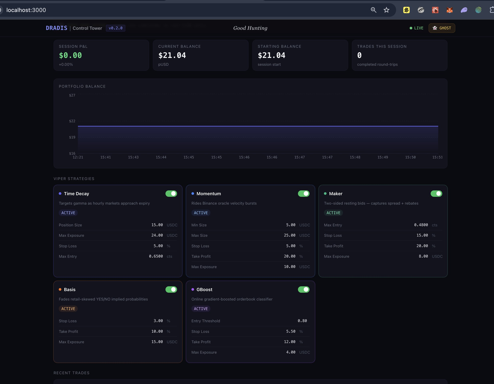

# Control Tower

The web dashboard that ships with DRADIS: live positions and P&L, configuration, setup and squadron management.

## Control Tower — The Dashboard

DRADIS ships with a real-time web dashboard called **Control Tower** built on Next.js 15 + Tailwind CSS.



| Panel              | What it shows                                                                                    |
|--------------------|--------------------------------------------------------------------------------------------------|
| **Status Bar**     | Engine online/offline, GHOST mode badge, active market, current BTC price, session P&L           |
| **P&L Chart**      | Rolling equity curve across recent snapshots                                                     |
| **Viper Cards**    | Live enabled/disabled toggle + all parameters editable inline without a restart                  |
| **Open Positions** | In-flight positions with entry time, side (YES/NO/UP/DOWN in correct color), entry price, shares |
| **Telemetry**      | Live Raptor macro cards — **Tide** (ETF premium, institutional pulse), **Horizon** (TradFi velocity, VIX proxy), greyed outside US market hours |
| **Markets**        | Browse the venue's live markets, open one and see its book beside the engine's own read of it: every Viper's verdict, the FairValue model reading, the bookmaker line. **Take the Helm** from there |
| **Trade Log**      | Last N completed trades with strategy, side, entry/exit prices, shares, P&L, exit reason         |
| **CAG Registry**   | Active squadrons with market, state, deployed time, and **+ Deploy** button                      |
| **Console**        | The engine's recent log, filtered by level, with **Copy visible** and a **Support bundle** button that saves one text file (version, venue, squadrons, every Viper's holding reason and refusal ledger, the live risk knobs, the log) to attach to a support request. It reads no credentials |
| **AI Actions**     | Full audit trail of LLM-proposed config changes — status lifecycle, delta %, tier, outcome score — with inline apply/reject for pending proposals |
| **Setup**          | Admin-gated credential management — venue keys, RPC, Alpaca, Telegram — with test-connection buttons, one-click engine restart, and the **AI Autonomy** panel (tier selector, kill switch, circuit-breaker reset) Switching venue gives the engine a new database shard; since 1.4.0 the new shard inherits the settings from the newest existing shard (ghost mode and the Helm switches start at their defaults) and a notice says so until the first save |

### Markets — the venue's picture beside the engine's

The **Markets** page answers "what does DRADIS think of this market, and why is it not trading it?" without a venue login or a log search. Pick a class (crypto, sports, politics) and a closing window, and the table lists the venue's live markets with their liquidity, time to close and, where a squadron is flying one, the squadron badge. Open a market and the page shows two things side by side:

- **The venue's picture.** Best bid and ask, mid and spread per side, the ask sum, then depth, the recent tape and a price history wherever the venue publishes them. Where it does not (Kalshi has no public price history, Polymarket US publishes neither prints nor history) the card says "not published by this venue" rather than showing a zero. A market the venue says is still accepting orders stays live past its listed close, which is how every sports market trades: Polymarket's listed end is kick-off. A closed market shows its resolution once the venue has one.
- **The engine's view.** If a squadron flies the market, every Viper's current verdict and the gate holding it. On any crypto up/down or strike market, the FairValue model's reading computed with the viper's own math on the global knobs: fair value per side, the edge against the required edge, the sigma it used and how many samples that rests on. On a sports market, the bookmaker consensus, book count and dispersion from the sports ledger. Plus DRADIS's own entries, exits and open positions on the market, from every shard.

**Take the Helm on this market** opens the Helm deploy flow preselected on it, so a browse becomes a hunt in one click. The page reads only through the venue abstraction, so all three venues get it, each to the depth its public API allows. Recorded (closed) markets and a per-market study mode are on the roadmap, not in this release.

### Live Config Editing

Every parameter in the Viper cards maps directly to the runtime `DynamicConfig`. Editing a value sends `PATCH /api/config` — **no restart required**. Changes take effect on the next 50ms tick.

> **Hot-Enable Design** — All twelve Vipers are always instantiated at startup. The `DynamicConfig` enable flags are the sole runtime gate. Toggle any Viper on or off during a live session with immediate effect.

### Setup Tab — No-Shell Credential Management

The **Setup** tab lets you configure DRADIS entirely from the browser — designed for prosumer deployments (e.g. a prebuilt AWS image) where editing `.env` on the server isn't practical.

Since 1.6.0 it is split into sub-tabs, each linkable as `#setup/<tab>` (Back and Forward move between them):

| Tab | What it holds |
|---|---|
| **Venue** | the trading venue, and collateral per exchange shard on Kalshi |
| **Credentials** | the venue's keys (wallet and RPC, Kalshi, or Polymarket US) |
| **Signals** | the Raptor signal sources and their feed settings |
| **Risk & Engine** | the risk profile, the [Capital Auto-Scaler](../ARCHITECTURE.md#capital-auto-scaler), and the instance-wide Deployment, Engine, Helm and GBoost Training settings |
| **AI & Alerts** | Telegram, the LLM advisor provider, AI autonomy |
| **Backup & Move** | the config bundle and Move to a New Instance |
| **Support** | where to get help |

Unsaved credential edits survive a tab switch, a tab holding them shows an amber dot, and the Save / Restart bar is on every tab.

- **First boot**: if no Setup password exists, the tab shows a first-boot wizard — create the password, enter venue credentials, restart.
- **Two passwords, not one**: the Control Tower login (`CT_USERNAME`/`CT_PASSWORD`; on the Marketplace AMI `admin` / the EC2 instance ID) opens the dashboard, and the **Setup password** you create in the wizard opens this tab. They are independent: the instance ID keeps opening the dashboard after the Setup password exists, and the Setup password is never the instance ID. The login card names which one it wants, and a wrong Setup password is reported as exactly that.
- **Admin gate**: setup routes require a login (argon2-hashed password, 24h HMAC session tokens); the rest of the dashboard is unaffected. Already protected by `CT_USERNAME`/`CT_PASSWORD` + `DRADIS_API_KEY`? Set `DRADIS_SETUP_AUTH=off` to skip the second password.
- **Lost the Setup password?** It is stored only as an argon2id hash (`DRADIS_ADMIN_HASH` in `$DRADIS_DATA_DIR/secrets.env`) and cannot be recovered or reset from the browser. From a shell on the instance, delete that line and restart the engine; Setup asks you to create a new password and nothing else is touched:

  ```bash
  sudo sed -i '/^DRADIS_ADMIN_HASH=/d' /opt/dradis/data/secrets.env   # Marketplace AMI path; self-hosted: $DRADIS_DATA_DIR/secrets.env
  sudo docker restart dradis
  ```

  Without shell access, launch a fresh instance and move to it with **Setup → Move to a New Instance** (1.2 and later) or a config bundle: neither carries the Setup password, so the new instance asks you to create one. See [docs/UPGRADING.md](UPGRADING.md).
- **Write-only fields**: the API never returns stored secrets — only a "set / …last4" hint.
- **Test buttons**: validate credentials live before saving (intl wallet → full CLOB auth + Safe derivation; Polygon RPC → `eth_blockNumber`; Alpaca → data probe; Telegram → `getMe`).
- **Storage**: saved to `$DRADIS_DATA_DIR/secrets.env` on the data volume; it **overrides** container env on boot, so values survive container recreation. **Restart engine** applies them (Docker respawns the process).

### Squadron Builder (Admiral Adama Extension)

The **+ Deploy** button in the CAG Registry panel opens the Squadron Builder modal — craft custom squadrons with market type selection, raptor/viper configuration, and regional deployment restrictions.

| Mode | Description |
|------|-------------|
| **Quick Deploy** | Select market type (crypto/sports/politics) → DRADIS auto-selects the highest-liquidity market and optimal raptors/vipers |
| **Full Control** | Browse available markets, manually select raptors and vipers, see implementation status badges |

**Market types by venue:**

Every venue accepts all three market types through the Squadron Builder. What
differs is which classes DRADIS also keeps running *on its own*.

| Deployment | Deployable | Auto-deployed | Notes |
|------------|-----------|---------------|-------|
| INTL (`intl_clob`) | Politics, Sports, Crypto | Politics, Sports | Crypto is kept running by the hourly rotation loop |
| US (`us_retail`) | Politics, Sports, Crypto | Politics, Sports | Crypto runs as an auto-managed wing (`us-crypto`) |
| Kalshi (`kalshi`) | Politics, Sports, Crypto | Politics, Sports | Crypto is kept running by the 15-minute rotation loop |

Crypto is deliberately *not* auto-deployed anywhere: every venue's rotation loop
or wing already keeps a crypto squadron running, so seeding another would put two
squadrons on the same underlying competing for the same capital. Politics and
sports have no such loop, which is why they need one. The two switches live in
Control Tower under Auto-Deploy Politics / Auto-Deploy Sports.

**Deployment flow:**
```
User → "+ Deploy" → Modal → POST /api/squadrons/deploy
                                    ↓
                        deployment_queue (pending)
                                    ↓
              venues::deployment::run_deployment_processor
              (5s poll — one consumer, shared by all venues)
                                    ↓
                  DeploymentRunner::run_pinned  →  squadron
                  (KalshiDeploymentRunner | UsDeploymentRunner
                   | cag::adama::IntlDeploymentRunner)
```

The same consumer drains the queue on every venue and seeds the auto-deploy
classes. Each venue supplies only a `DeploymentRunner` — how to resolve a market
id and trade it. A deployment interrupted by a restart is requeued rather than
lost, so restarting the engine for a config change does not silently drop the
squadrons you deployed.

Staged squadrons appear in the CAG Registry. The auto-discovery loops for crypto assets (BTC/ETH/SOL) adopt staged deployments on their next market rotation.

### Authentication

```bash
# .env (production — self-hosted)
CT_USERNAME=starbuck
CT_PASSWORD=your-strong-password
```

**On the AWS Marketplace AMI these are set for you at first boot**
(`deploy/ami/dradis-firstboot.sh`): the username is `admin` and the password is
the **EC2 instance ID**, fetched via IMDSv2. So the first login on a fresh
instance is `admin` / `i-0abc123…`.

That instance ID is a **claim token, not the real credential**. It proves you can
see the instance in your own AWS console, and getting past it lands you on a
screen that forces you to create a **Setup password** before any credential can
be entered. That password is hashed with argon2 under an OS-RNG salt and is the
credential that protects the Setup view — wallet keys, API secrets, config
import — from then on. The setup status response advertises `admin_set`
precisely so the UI can enforce this on first run.

The two are separate and stay separate: the Control Tower login keeps working
with the instance ID (until you change `CT_PASSWORD`), and the Setup password is
whatever you created, never the instance ID. Setup's login card says which one
it is asking for, and rejects a wrong one by name, because an operator who has
just typed the documented credential into that box and been refused otherwise
concludes the documented credential is broken.

The reason the distinction matters: an instance ID is not a secret. It appears in
the EC2 console listing, in tags, in any `ec2:DescribeInstances` response, in
support tickets and in screenshots. Used as a standing password that would be
weak, but used once to claim an instance it is the conventional appliance
pattern, and it keeps first login simple for an operator who has just launched
from the Marketplace.

The residual risk is the claim window. Between first boot and your first login,
anyone who already has read-only EC2 access to the same account could pass basic
auth and claim the instance by setting the admin password before you do. So log
in and set yours promptly, restrict 80/443 to your own address, and set your own
`CT_PASSWORD` as well before opening the dashboard more widely.
